# WordClock

This is the <b>WordClock</b> software to the thingiverse project: <a href="https://www.thingiverse.com/thing:4693081">Wordclock Wortuhr</a>. Also available for download on <a href="https://www.printables.com/de/model/311949-wordclock-2022">Prusa Printables</a>.

Feel free to add functions, ideas and everything else, which helps this project to grow! 

<h3><b>Current version: V6.1.0     </b></h3>

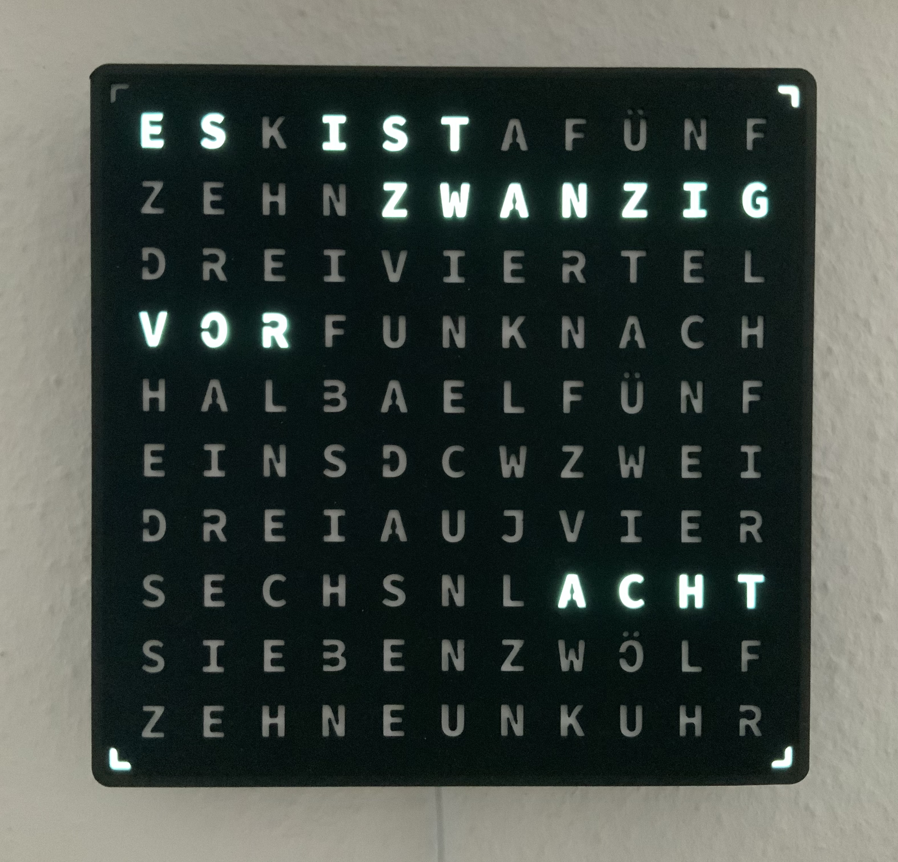

Time here is 07:43 or 19:43 o'clock

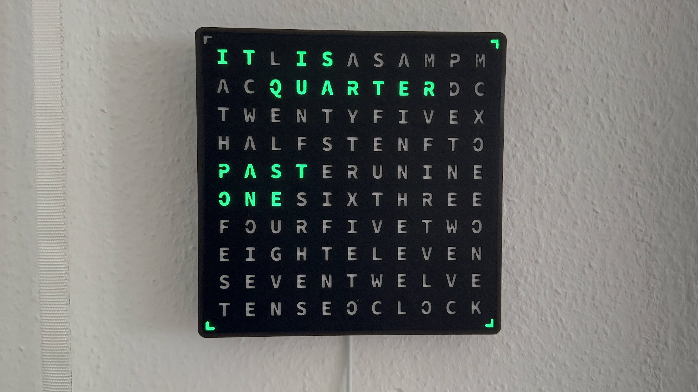

English variant available too. Time here is 01:18 or 13:18 o'clock.

<h3><b>Video:</b></h3>

Music credit: Used some free music from Apple iMovie

<h3><b>Required Hardware:</b></h3>

- ESP8266 board (NodeMCU V3 or D1 mini) or an ESP32 board (ESP32, ESP32-S3, ESP32-C3, f.e. Waveshare ESP32-S3-Zero)
- RTC (DS3231) board (optional, recommended: the clock then shows the time without WiFi too)
- 114 LEDs of an WS2812B led stripe 
- Powersupply 5V / >=3A

<h3><b>How to setup the Arduino IDE to support the ESP8266 and select the NodeMCU board:</b></h3>

- Please use this manual: https://randomnerdtutorials.com/how-to-install-esp8266-board-arduino-ide/
- ESP8266: board "NodeMCU 1.0 (ESP-12E Module)" or "LOLIN(WEMOS) D1 R2 & mini", ESP8266 core 3.1.x
- ESP32: ESP32 core 3.x by Espressif (board manager URL https://espressif.github.io/arduino-esp32/package_esp32_index.json).
  Select the board of your chip ("ESP32 Dev Module", "ESP32S3 Dev Module" or "ESP32C3 Dev Module") and set
  - Partition Scheme: "Minimal SPIFFS (1.9MB APP with OTA/190KB SPIFFS)" - the automatic update needs it
  - USB CDC On Boot: "Enabled" (ESP32-S3 and ESP32-C3 boards with USB-C on the chip, for the serial monitor)
- First installation on an ESP32 without the Arduino IDE: flash the file <code>WordClockWithWeb.ino.&lt;CHIP&gt;.factory.bin</code>
  from the release at address 0x0, f.e. with https://espressif.github.io/esptool-js/ in Chrome or Edge.

<b>Default pins</b> (GPIO numbers, can be changed in the web interface under System &rarr; Hardware and are kept during updates):

| Chip | LED data | RTC SDA | RTC SCL |
|------|----------|---------|---------|
| ESP8266 (NodeMCU, D1 mini) | 12 (D6) | 4 (D2) | 5 (D1) |
| ESP32 | 16 | 21 | 22 |
| ESP32-S3 | 2 | 8 | 9 |
| ESP32-C3 | 10 | 8 | 9 |

<h3><b>Required libraries:</b></h3>

Install these libraries in the Arduino IDE library manager (the ESP8266Ping library from GitHub as ZIP):

- Adafruit NeoPixel (by Adafruit)
- RTClib (by Adafruit) together with Adafruit BusIO
- WiFiManager (by tzapu / tablatronix)
- ArduinoJson (by Benoit Blanchon), version 7 or newer
- ESPping (by dvarrel): https://github.com/dvarrel/ESPping (replaces ESP8266Ping since V6.1.0, works on ESP8266 and ESP32)

<h3><b>Available functions:</b></h3>

- Note: Check the settings.h file for the latest functions
- WiFi Manager integration to avoid setting your WiFi credentials manually in the code
- The from your WiFi router received IP-address can be shown as a scrolling text to inform you about the current value
- During startup in default a LED test function is shown to check your wiring. All LEDs should light up in green color and turn off again
- Without WiFi the clock shows the time of the DS3231 RTC, also right after power-up. After each NTP sync the RTC is set again (stored as UTC, so daylight saving time also works offline). Without RTC and without WiFi the text “SET WLAN“ (DE) or “WIFI“ (EN) is shown
- The configuration is done in the integrated web interface, f.e. http://WordClock0.local or http://192.168.178.50 (depending on your settings). It shows a live preview of the clock face, works on phones and supports light and dark mode
- The LED color can be configured to a static value
- The LED intensity can be set for a day time and optional for a night mode usage
- To every new hour the hour text can flash orange to notify about the new reached hour
- Optionally the date can scroll across the clock hourly at :30 or every 30 minutes
- A time span can be selected to turn off the LEDs fully or reduce their intensity for night time usage for each day seperately
- Updates of the software can be done with the web portal as well to avoid connecting the device to Arduino IDE again. The needed .bin file is included
- During startup you can choose if the following functions should be displayed: IP-address as scrolling text, the SET WLAN/WiFi text and/or the LED test function
- The LED color can be shown as randomised 'rainbow' color changed every new minute or every word can be shown in its own random color, also changed every new minute
- You can choose if the minute LEDs in the corners should be rotated in clockwise or anti clockwise direction
- The in the internal WifiManager stored WiFi settings can be set to default on request to switch to a new WiFi router afterwards
- If the clock cannot connect to the saved WiFi at startup, it opens the setup hotspot "WordClock" for 240 seconds while it keeps showing the time. Afterwards it keeps trying the saved WiFi in the background. To enter new WiFi data, restart the clock and connect to the hotspot
- You can configure the hostname of the device that will be tried to tranfer to your routers DNS configuration to reach the web portal via DNS name too
- A restart request can be forced with the web portal as well
- The timezone and NTP-Server configuration can be configured as well to fit to your demands
- Optional you can set up to 3 IP-addresses (of f.e. your smart phones) connected on your network to be monitored via PING requests 2x per minute. After a set amount of failed PING attempts the WordClock LEDs will turn off to reduce power consumption when you are not at home
- Automatic update without the need of a computer: the web interface checks the GitHub releases of this repository and installs a newer version with one click. The download and update progress is shown on the clock display.
- German and English layout variant of the WordClock. The DE/EN switch at the top right of the web interface sets the clock layout and the language of the web interface. REST command texts are always in English.

<h3>Web configuration interface:</h3>

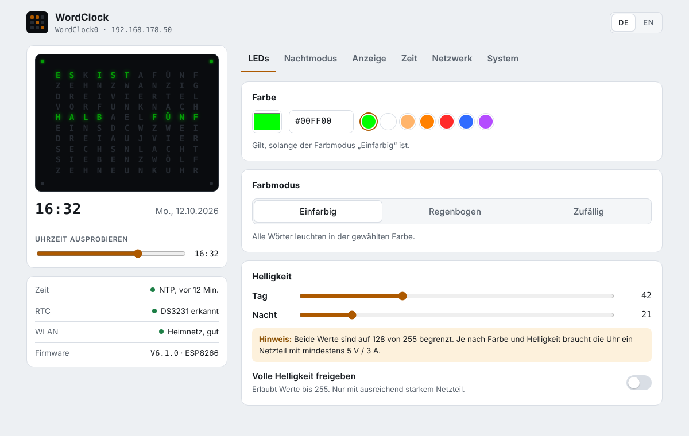

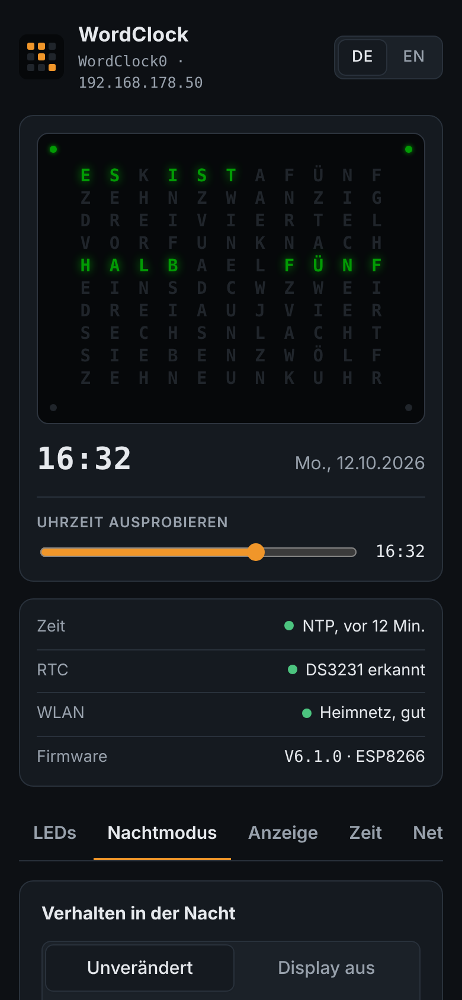

<h3>Wiring instructions:</h3>

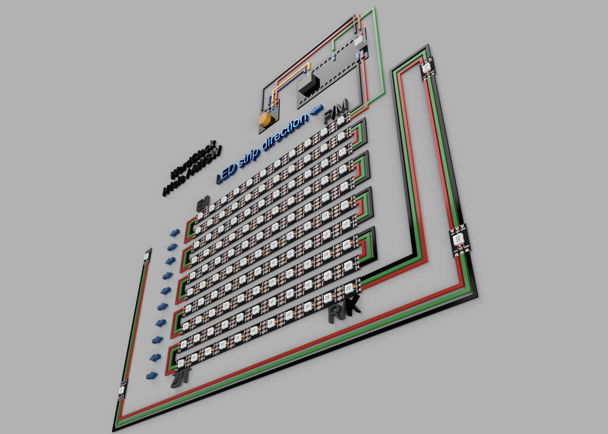

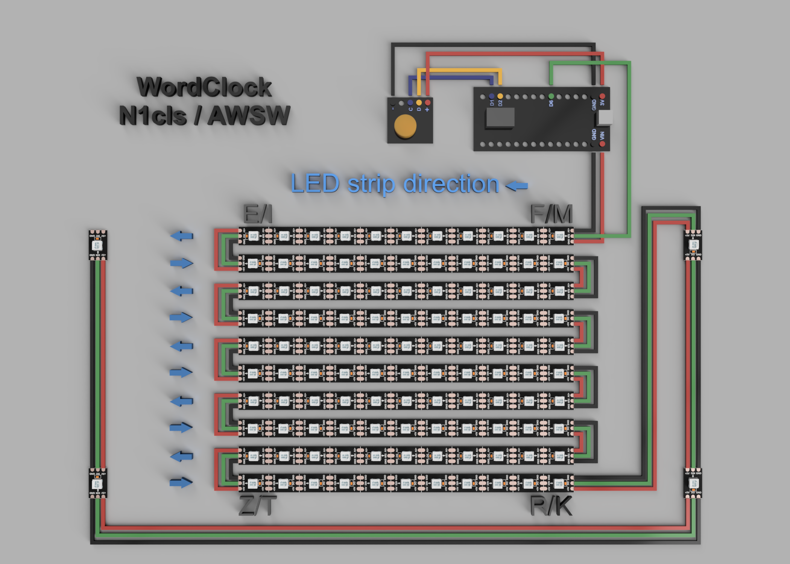

<b>Note:</b> Take care of the LED strip direction as shown in the pictures. The LEDs have little arrows that will tell you their direction:

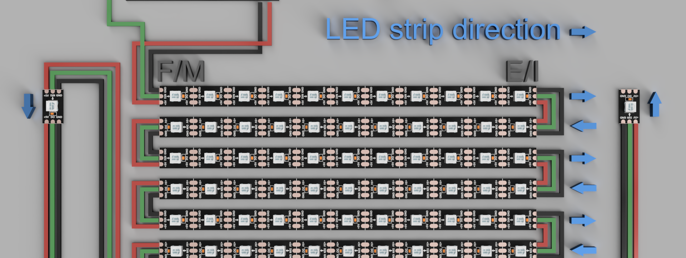

<h3><b>Version history:</b></h3>

- 1.0 to 3.4: 	Initial releases shared on thingiverse
- 3.5 to 3.9.3:	Minor function changes and code cleanup
- 4.0: 		Added an option to periodically ping a IP-address of f.e. your smart phone. 
		If the IP-address does not answer for a period of time the LEDs turn off. 
		This will allow to reduce power consumption of the WordClock when you are away.
		The ping request is done 2x every minute. So if the IP-address can be reached
		again, the LEDs will turn on after a few seconds
- 4.1: 		Minor text changes
- 4.2: 		Integrated 2 REST urls to manually turn the LEDs on or off from an external control like f.e. your smart home controller
- 4.3: 		Minor text changes. Added 2 more REST urls for an experimental twinkle mode LED test
- 4.4: 		Changed the startup LED test function to reduce power consumption to fit 5V/3A power supplies, changed the maximum setting for the brightness sliders to 128 from 255. A note for the power supply check was added. The RESET and WiFI RESET function were recreated to remove an error
- 4.5: 		Added an option to apply the power supply message and to raise the maximum LED intensity again to 255. Code cleanup. Changed the HTML page settings to show german umlauts (äöüß) now correctly.
- 4.6: 		Enhanced the PING option for now up to 3 IP-addresses that can be monitored. Code cleanup. Added another url to be able to querry the status of the LEDs.
- 4.7: 		Code cleanup. Added a small How-To to add the WordClock REST urls to HomeBridge to be able to control the WordClock from HomeKit and via Siri.
- 4.8:          Added a WiFi reconnect function in case the WiFi connection gets aborted during longer usage. Added a live update of the intensity value text fields next to the 2 sliders. Smaller changes to some functions.
- 4.9:          Added a radio button selector to switch between 2 rainbow color modes. Added a URL to get to the Wordclock repository page on GitHub.
- 5.0:		Added language support for the HTML configuration interface for english and german. German language is the default.
- 5.1:		Small bugfix for the new language support function.
- 5.2:		Optional: Automatic update without the need of a computer. The configuration page will show the available version to update to and
		with a single click on the note the update will be done automatically. The download and update progress is shown on the clock display.
		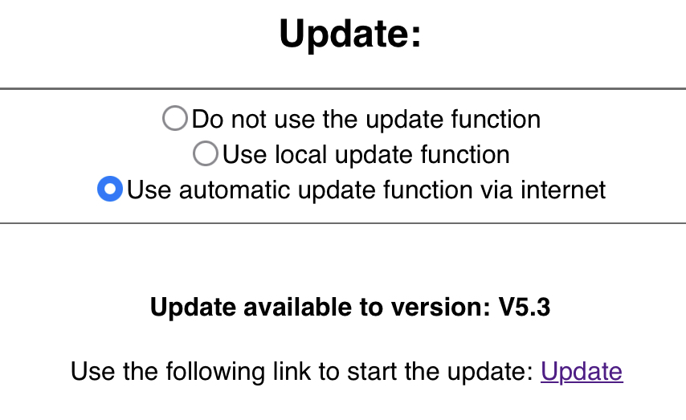
- 5.3		Optional: Remove the need of an RTC board, because the WiFi is always connected for the configuration page access of the WordClock. No configuration needed. If there is no RTC detected a note is shown until the configuration page is saved once. Tested with and without an RTC on a WordClock.
- 5.4			BugFix to version 5.3 when no RTC board is used the current time was not updated every minute
- 5.5			Added language support for the english layout variant of the WordClock. The switch between the german or english layout is done by selecting the language in the web configuration.
- 5.6          Version 5.6 was used for software update tests from 5.5 to 5.5 and will not be released, because it was 5.5.
- 5.7          Thanks to a user feedback the english time texts could be updated to a more propper english.
- 5.8          Added a DE special function: Change between "VIERTEL VOR" = "0" and "DREIVIERTEL" = "1" in settings.h possible.
- 5.9          Added a DE special function from V5.8 to web interface in German language setting. 2 small bug fixes that prevented changes to color and intensity settings when the Day/Night mode setting was turned on.
- 5.9.1        Added a DE special function: Change between "VIERTEL NACH" = "0" and "VIERTEL" = "1" in settings.h possible.
- 5.9.2	   Small correction to V5.9.1 in DE language.
- 5.9.3	   Changed the scrolling text to display the date from every 30 seconds to every 30 minutes, so hour + 30 minutes on request.
- 5.9.4	   Small correction to avoid a behavior when night time was reached and the PING function was used. The display was set to day brightness every 30 seconds again.
- 5.10.4   CHange the web interface and the internal logic to configure the sequence of the 4 corner LEDs
- 6.0.0    New web interface with live preview of the clock face, served compressed from flash with a small JSON API (less RAM usage).
           Automatic update now uses the GitHub releases of this repository. Date as scrolling text hourly or every 30 minutes.
           Button to test the corner LEDs. Enabling the REST function no longer crashes the clock without a restart.
- 6.1.0    The DS3231 RTC is used when there is no WiFi: the time is shown right after power-up and the WiFi setup no longer blocks the clock.
           ESP32, ESP32-S3 and ESP32-C3 support, pins configurable in the web interface. Night mode weekdays fixed for clocks without RTC.
           Rainbow mode: every word (ES and IST included) in its own random color, new every minute.
           Web interface: preview with the letters of the front plate, current color in the random color mode.
           Library change for compiling: ESPping (works on ESP8266 and ESP32) replaces ESP8266Ping, ArduinoJson 7 is needed.

<h3><b>For developers:</b></h3>

- The web interface source is <code>web/index.html</code> (plain HTML, CSS and JavaScript). The firmware serves a gzipped copy
  from <code>WordClockWithWeb/webpage.h</code>, a generated file - do not edit it. The GitHub Action rebuilds it from
  <code>web/index.html</code> on every push and commits it, so changing <code>web/index.html</code> is enough.
  To try a changed page on your own clock before pushing, run <code>python3 tools/build_webpage.py</code> and upload the sketch.
  Opened directly from disk, the page runs in a demo mode with example values.
- Releases: create a GitHub release with a tag equal to <code>WORD_CLOCK_VERSION</code> (f.e. <code>V6.0.0</code>).
  The GitHub Action builds the firmware for ESP8266, ESP32, ESP32-S3 and ESP32-C3 and attaches
  <code>WordClockWithWeb.ino.&lt;CHIP&gt;.bin</code> (update file, used by the automatic update) and for the ESP32 chips
  <code>WordClockWithWeb.ino.&lt;CHIP&gt;.factory.bin</code> (complete image for the first installation) to the release.

<h3><b>Upcomming and planned functions:</b></h3>

- Currently no further features planned... Working on an <a href="https://www.printables.com/de/model/331012-wordclock-16x16-led-matrix">ESP32 version with a 16x16 LED matrix and more smart home integration</a> as well as on a <a href="https://www.printables.com/de/model/350568-wordclock-16x16-led-matrix-2023">ESP32 version with a 16x16 LED matrix without smart functions (2023)</a> to minimize soldering work to just 3 wires and to have more performance for more features. The here used ESP8266 board really gets to its limits in some cases already...

<h3><b>How-To's:</b></h3>

<b>Add WordClock to Homebridge and control it with HomeKit and via Siri in your smart home:</b>

<b>Note:</b>
- The here meantioned REST url functions will work similar f.e. in HomeAssistant or other solutions too.

<b>Preconditions:</b>
- Your smart home alreday runs "HomeBridge" (https://homebridge.io) and the here shown "Homebridge UI" plugin (https://github.com/oznu/homebridge-config-ui-x) to add the configuration via web interface.

<b>Setup:</b>
- In HomeBridge add the following plugin "Homebridge Http Switch" (https://github.com/Supereg/homebridge-http-switch) 

- After the installation the "Homebridge Http Switch" plugin will be shown:
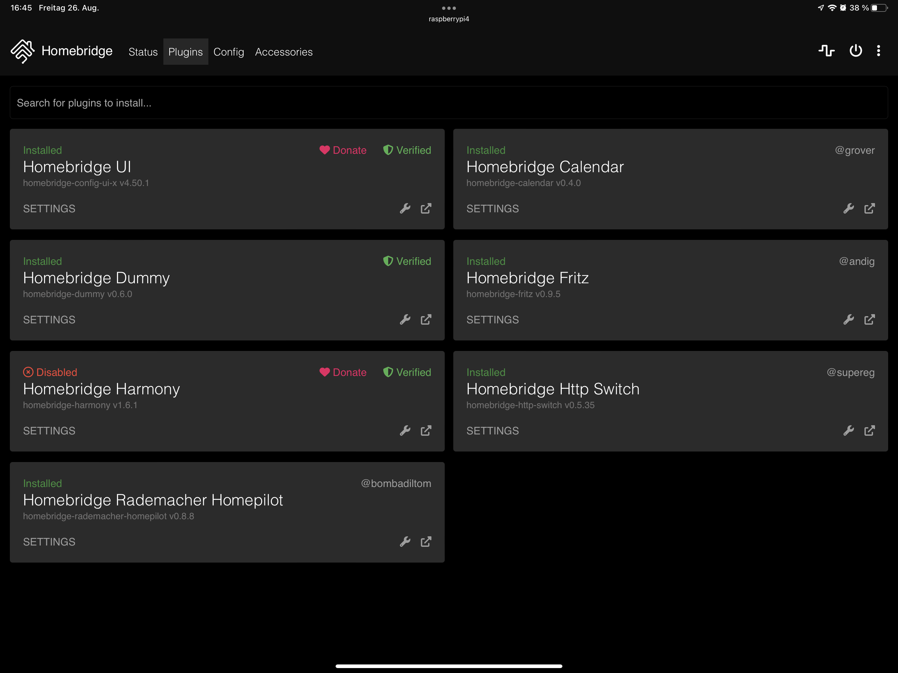

- Configure its "Settings" and add the WordClock as a new "Accessory": 
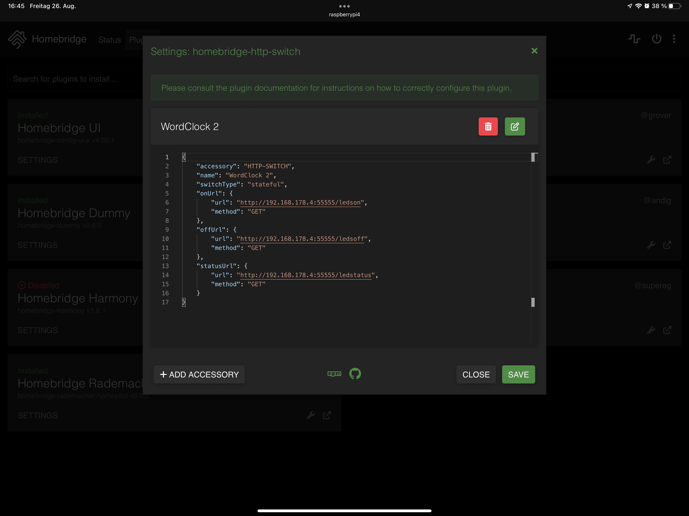

- Add the following code to the accessory after changing the value "WordClockIP" to your WordClock IP-address as well as the "name" value:

<pre><code>
{
    "accessory": "HTTP-SWITCH",
    "name": "WordClock 2",
    "switchType": "stateful",
    "onUrl": {
        "url": "http://WordClockIP:55555/ledson",
        "method": "GET"
    },
    "offUrl": {
        "url": "http://WordClockIP:55555/ledsoff",
        "method": "GET"
    },
    "statusUrl": {
        "url": "http://WordClockIP:55555/ledstatus",
        "method": "GET"
    }
}

</code></pre>

- Save the changes and use the HomeBridge UI control to restart HomeBridge.

- After the HomeBridge restart your WordClock can be controlled to turn the LEDs OFF and ON in HomeBridge, HomeKit, automation scenarios and via Siri:
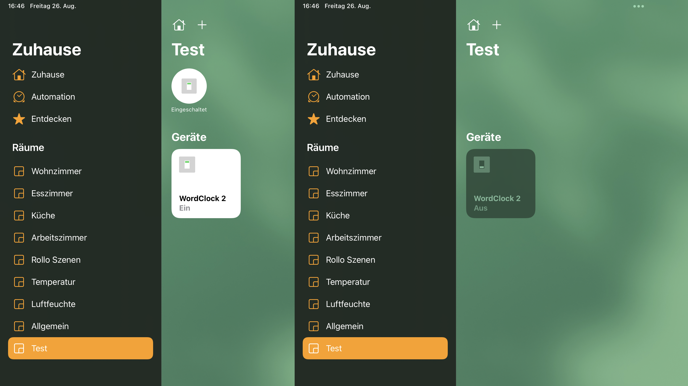

